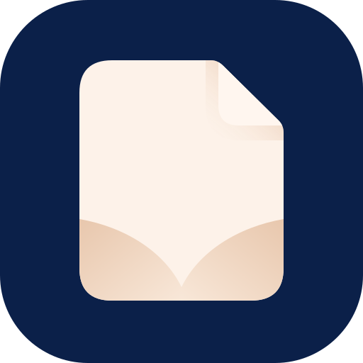
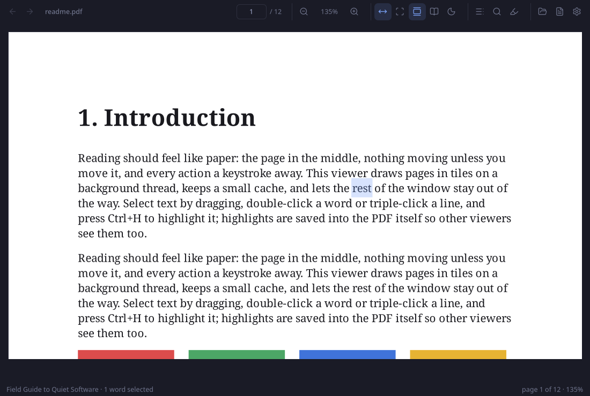
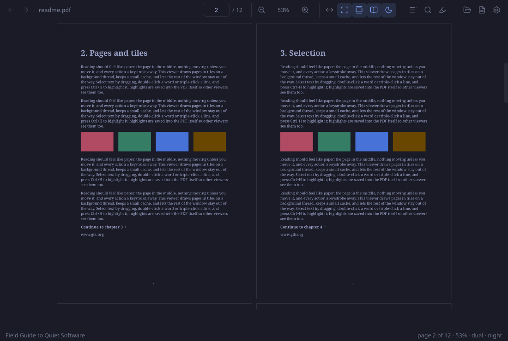
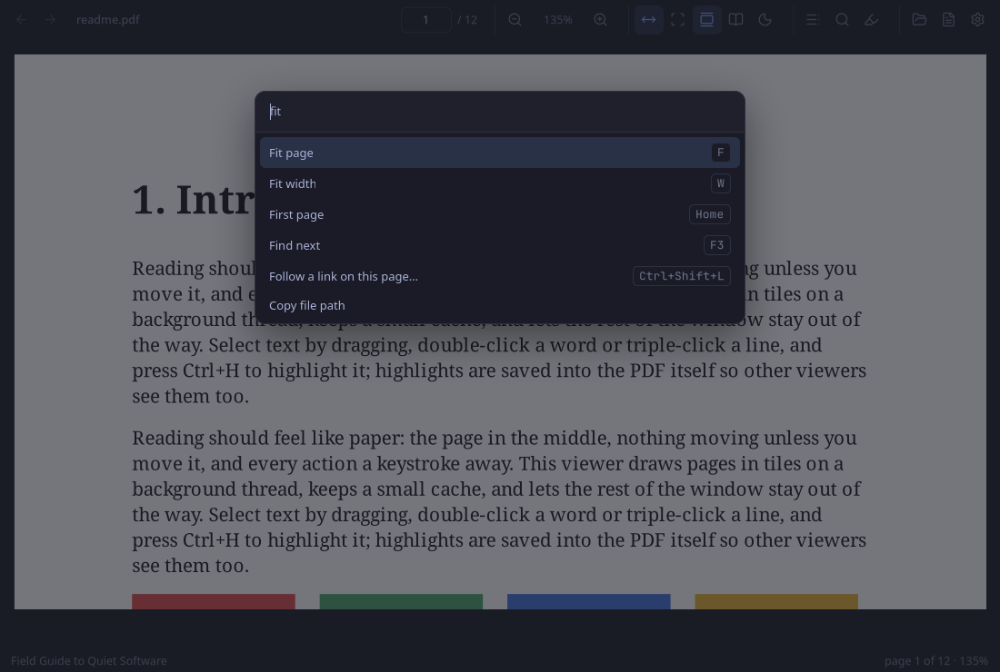
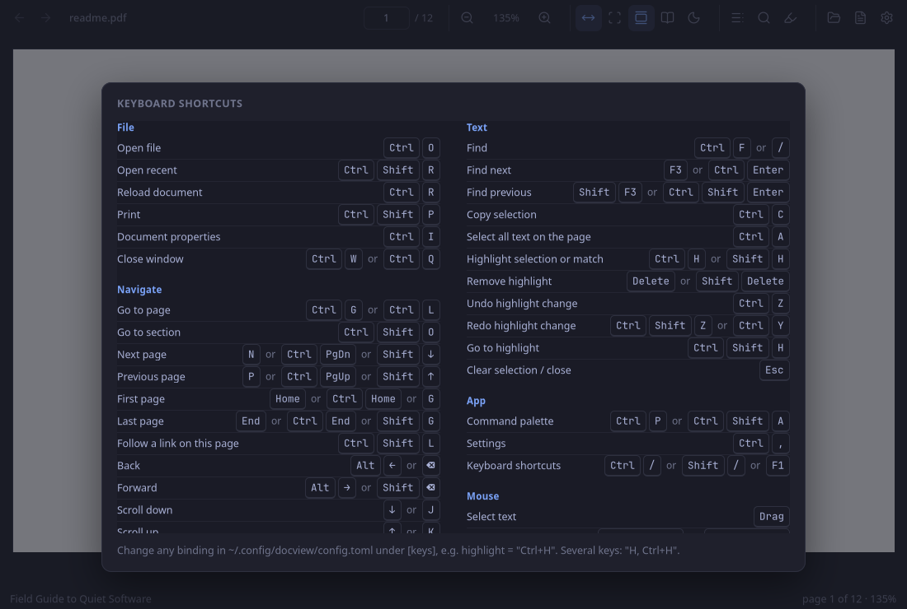

<div align="center">



# docview

**A small, fast PDF and web page viewer for Linux that stays out of your way.**

Pages in the middle, two thin bars, and every action one key away. It renders
in the background, keeps a small, capped cache, and uses no CPU while you read.

[Install](#install) · [Features](#features) · [Keyboard](#keyboard) · [Settings](#settings) · [Your data](#your-data) · [Building](#building-from-source)



</div>

docview is built with Rust, [GTK 4](https://gtk.org) and
[poppler](https://poppler.freedesktop.org), the same PDF engine GNOME's
Papers uses. Web pages are shown with [WebKitGTK](https://webkitgtk.org), the
engine behind GNOME Web. It is part of the same family as
[allwrite](https://github.com/ahaan-shah/allwrite): the same look, the same
command palette and shortcut sheet, and it follows your
[pywal](https://github.com/dylanaraps/pywal) colours live. It was made for
Hyprland, and runs on any Linux desktop.

## Features

**Reading.**
- Continuous scrolling or one page at a time, single pages or two-page spreads (with the cover on its own, like a book).
- Fit width, fit page, or any zoom from 10% to 800%: `Ctrl` + wheel and pinch zoom around the pointer.
- Night mode recolours pages with your theme's background and text colours, and keeps figures recognisable.
- Rotate pages, presentation mode (`F5`), focus mode that hides the bars, and fullscreen.
- docview remembers where you were in every document, and its zoom, layout and rotation.



**Text.**
- Select by dragging, double-click a word, triple-click a line, `Shift`-click to extend. Selections can span pages, and are also put on the primary selection for middle-click paste.
- Find (`Ctrl F`) searches the whole document on a background thread, shows every match, and counts them as it goes.
- Highlights (`Ctrl H`) are saved into the PDF itself, so every other viewer sees them. With nothing selected, `Ctrl H` highlights the current search match, so you can highlight without touching the mouse. Remove with `Delete`, undo and redo with `Ctrl Z` / `Ctrl Shift Z`, and jump between them with `Ctrl Shift H`. Right-click the highlight button to pick its color; a left click uses the last one.

**Getting around.**
- Type a page number or label (`iv`, `12`) in the top bar, or press `Ctrl G`.
- Go to any section of the outline (`Ctrl Shift O`) or any link on the page (`Ctrl Shift L`) from a searchable list.
- Links work, with back and forward (`Alt ←` / `Alt →`) like a browser.

**Web pages too.** Open an `.html` file and docview shows it with WebKit, the
engine behind GNOME Web. The top bar switches to what a page needs:

- Back and forward through the page's links.
- Zoom (`Ctrl =` / `Ctrl -`, or `Ctrl` + wheel).
- Night mode (`Ctrl Shift N`).
- Find (`Ctrl F`).
- Reload (`Ctrl R`).
- Open in your browser (`Ctrl Shift B`).

The page gets plain keys, so scrolling and typing into forms work as in a
browser. Edit the file and the page reloads.

WebKit is loaded only when you open a page. Reading PDFs never pays for it, and
it closes again when you go back to a PDF. A page costs about 200 MB across
docview and WebKit's processes, like a browser tab. This needs WebKitGTK 6:
`webkitgtk-6.0` on Arch, `libwebkitgtk-6.0-4` on Debian and Ubuntu,
`webkitgtk6.0` on Fedora. Without it, PDFs work as before.

**Every action in one place.** All actions live in a single command
registry, so the top bar buttons, keyboard shortcuts and the command palette
(`Ctrl P`) can never drift apart. The palette also opens recent files.

<table>
<tr>
<td></td>
<td></td>
</tr>
</table>

**Your colours, live.** Three colour modes: system, light and dark
(`Ctrl Shift T` or settings). In system mode docview reads pywal's `colors.json`
and recolours the moment your wallpaper changes, with no restart; without pywal
it follows your desktop's light or dark preference and accent colour through
the XDG portal.

**Light on your computer.**
- With a 1,300-page book open it uses about **60 MB** of memory, and stays around 100–120 MB while you scroll, zoom and search through it. Rendered tiles live in a cache capped at 48 MB (`cache_mb`).
- First page on screen in about 0.2 seconds, even for large books.
- No CPU while idle: there are no timers or polling. The file and your palette are watched with inotify.
- Software rendering, so it never wakes a sleeping discrete GPU on hybrid laptops.

**Live reload.** When the PDF changes on disk (say, LaTeX rebuilt it),
docview reloads it and keeps your place.

**Safe with your files.** Saving highlights writes a temporary file and
renames it over the original, so a crash never leaves a half-written PDF.
docview never changes a document unless you add or remove a highlight.

## Install

### One line (any Linux distribution)

```bash
curl -fsSL https://raw.githubusercontent.com/ahaan-shah/docview/main/install.sh | sh
```

The script installs `docview` into `~/.local/bin` and adds a menu entry and
icon, just for you (no root). It works on x86-64 and ARM64 and checks the
download against the release's `checksums.txt`.
- To also make docview your default app for PDF files, use `sh -s -- --default` in place of `sh`.
- To install a specific version, set `DOCVIEW_VERSION=0.1.0` first.
- To uninstall, use `sh -s -- --uninstall` in place of `sh`. Your settings are kept.

docview needs **GTK 4** and **poppler-glib**, which most desktops already have:

| Distribution | Packages |
|---|---|
| Arch | `gtk4 poppler-glib` |
| Debian / Ubuntu | `libgtk-4-1 libpoppler-glib8` |
| Fedora | `gtk4 poppler-glib` |

Optional:
- WebKitGTK 6 to open HTML files: `webkitgtk-6.0` on Arch, `libwebkitgtk-6.0-4` on Debian and Ubuntu, `webkitgtk6.0` on Fedora. The `.deb` and `.rpm` packages recommend it.
- `python-pywal` (or `pywal16`) for live colours.

### Debian, Ubuntu and Fedora packages

The [latest release](https://github.com/ahaan-shah/docview/releases/latest)
has `.deb` and `.rpm` packages for x86-64 and ARM64, and portable `.tar.gz`
archives with the binary, icon and `.desktop` file.

```bash
sudo apt install ./docview_*_amd64.deb        # Debian / Ubuntu
sudo dnf install ./docview-*.x86_64.rpm       # Fedora
```

### Arch Linux

```bash
git clone https://github.com/ahaan-shah/docview.git
cd docview/packaging && makepkg -si
```

## Keyboard

| Keys | Does |
|---|---|
| `Ctrl O` · `Ctrl Shift R` · `Ctrl R` | Open · open recent · reload |
| `Ctrl P` | Command palette |
| `Ctrl ,` | Settings |
| `Ctrl K` or `Ctrl /` | All shortcuts |
| `↑` `↓` `←` `→` or `J` `K` `H` `L` | Scroll |
| `Space` · `Shift Space` · `PgDn` · `PgUp` | Scroll a screen |
| `N` · `P` | Next · previous page |
| `Home` / `G` · `End` / `Shift G` | First · last page |
| `Ctrl G` | Go to page |
| `Ctrl Shift O` · `Ctrl Shift L` | Go to section · follow a link |
| `Alt ←` · `Alt →` | Back · forward |
| `Ctrl =` / `=` · `Ctrl -` / `-` · `Ctrl 0` · `Z` | Zoom in · out · 100% · zoom to… |
| `W` · `F` | Fit width · fit page |
| `C` · `D` · `Shift D` | Continuous · dual pages · cover page |
| `I` / `Ctrl Shift N` | Night mode |
| `Ctrl Shift T` | Color mode: system (pywal), light, dark |
| `Ctrl B` | Show or hide the top bar |
| `R` · `Shift R` | Rotate clockwise · counterclockwise |
| `F5` · `F11` · `Ctrl Shift F` | Presentation · fullscreen · focus mode |
| `Ctrl F` or `/` · `F3` / `Shift F3` | Find · next / previous match |
| `Ctrl C` · `Ctrl A` | Copy · select the page's text |
| `Ctrl H` · `Delete` · `Ctrl Shift H` | Highlight · remove highlight · go to highlight |
| `Ctrl Z` · `Ctrl Shift Z` | Undo · redo highlight changes |
| `Ctrl I` · `Ctrl Shift P` | Document properties · print |
| `Esc` | Clear the selection, close find, leave presentation |
| `Ctrl W` / `Ctrl Q` | Close |

On a web page, keys without `Ctrl` or `Alt` go to the page, as in a browser:
arrows, `Space` and `PgDn` scroll, and you can type into forms. Shortcuts with
`Ctrl`, `Alt` or an F-key work as above, plus:

| Keys | Does |
|---|---|
| `Ctrl Shift B` | Open the page in your web browser |
| `Ctrl` + wheel | Zoom |

Any shortcut can be changed in the config file (see below).

### From the command line

```bash
docview                  # recent documents
docview paper.pdf        # open a document
docview notes.html       # open a web page
```

To make docview the default for web pages too (it does not become the
default for anything on its own):

```bash
xdg-mime default docview.desktop text/html
```

## Settings

Most settings are in the settings panel (`Ctrl ,`) and apply immediately.
They're saved to `~/.config/docview/config.toml`, which you can also edit by
hand:

```toml
[view]
fit = "width"            # "width", "page" or "none" (then `zoom` is used)
zoom = 1.0
continuous = true
dual = false
cover = true             # in dual mode, the first page sits on its own
night = false

[app]
restore_position = true
highlight = "color3"     # pywal slot (color1..color15, accent) or "#rrggbb"
font = "Inter"           # UI font
cache_mb = 48            # memory for rendered pages
mode = "system"          # "system" (pywal, else desktop light/dark), "light" or "dark"
topbar = true

[keys]                   # command id = key combo; several: "H, Ctrl+H"
highlight = "Ctrl+H"
night = "Ctrl+Shift+I"

[theme]                  # palette slot = pywal key or hex colour
accent = "color4"
```

Command ids are listed in [`src/commands.rs`](src/commands.rs).

## Your data

There's no account, no telemetry and no update check. Reading PDFs never
touches the network. A web page loads what it links to (images, fonts, other
pages), as it would in a browser. docview keeps a list of recent files and your place in each
document in `~/.local/state/docview/state.json`.

## Building from source

You need Rust (stable) and the GTK 4 and poppler-glib development files
(Arch: `gtk4 poppler-glib`; Debian / Ubuntu: `libgtk-4-dev libpoppler-glib-dev`;
Fedora: `gtk4-devel poppler-glib-devel`). WebKitGTK isn't needed to build:
docview loads it at run time, the first time a web page is opened.

```bash
cargo build --release          # target/release/docview
cargo test --release
scripts/install.sh             # install the build into ~/.local (--default: default PDF app)
```

`cargo run --example make_sample -- sample.pdf` writes the sample document
used for the tests and the screenshots above.

## License

MIT
